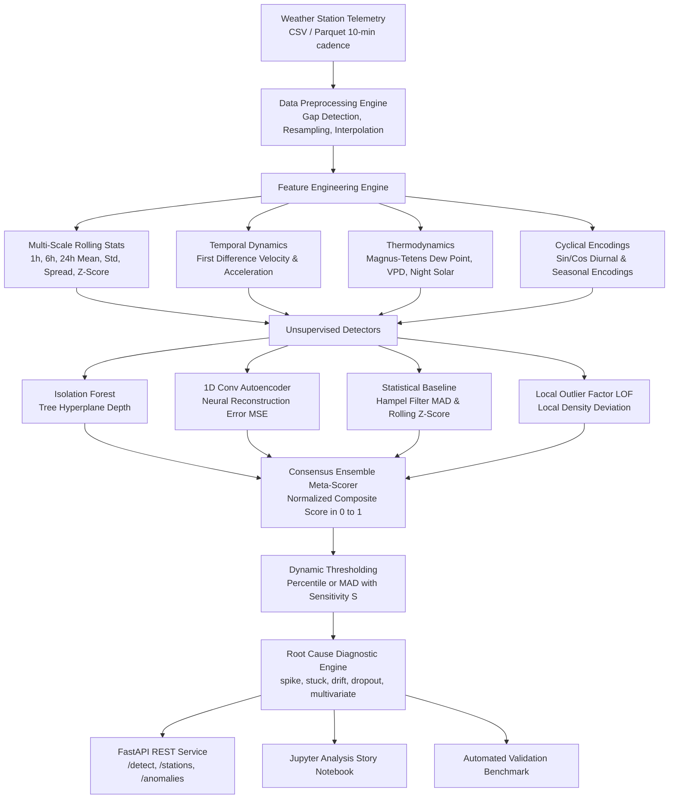

# 🛡️ SkyGuard: Unsupervised Weather Station Sensor Anomaly Detection System

[](https://www.python.org/)
[](https://fastapi.tiangolo.com)
[](https://pytorch.org)
[](LICENSE)
[](#continuous-integration--deployment)

**SkyGuard** is an industrial-grade unsupervised machine learning and atmospheric physics guardrail system engineered for Automated Weather Station (AWS) networks and environmental IoT telemetry. It detects, diagnoses, and categorizes sensor faults without requiring labeled historical anomalies.

---

## 📌 Problem Overview & Context

Automated weather stations monitor climate conditions 24/7 across remote mountaintops, agricultural research stations, airports, and desert regions. Telemetry is sampled every 10 minutes across seven critical environmental channels:
1. **Temperature ($T$)** [°C]
2. **Relative Humidity ($RH$)** [%]
3. **Barometric Pressure ($P$)** [hPa]
4. **Wind Speed ($V$)** [m/s]
5. **Wind Direction ($\\theta$)** [degrees]
6. **Rainfall ($R$)** [mm]
7. **Solar Radiation ($GHI$)** [W/m²]

### Sensor Fault Archetypes
Because sensors are subjected to extreme thermal cycling, icing, dust, lightning, and power drops, they frequently experience faults:
- **Impulse Glitches / Spikes**: Electrostatic discharge or ADC bit-flips causing abrupt, unphysical jumps.
- **Sensor Freeze / Flatlines (`stuck`)**: Mechanical freezing of anemometers or frozen I2C/SPI bus where readings remain constant despite ambient environmental fluctuations.
- **Calibration Drift (`drift`)**: Slow, progressive bias degradation over weeks/months in pressure transducers or pyranometers.
- **Dropouts (`dropout`)**: Sudden drops to 0.0 or sensor floor caused by loose wiring, sensor resets, or battery depletion.
- **Multivariate Physical Contradictions (`multivariate`)**: Physical decoupling where individual channels appear plausible in isolation, but violate thermodynamic laws (e.g. solar irradiance $> 500\\text{ W/m}^2$ at midnight, relative humidity $> 100\\%$, or temperature plunging below dew point).

---

## 🏗️ System Architecture



---

## 🔬 Unsupervised Machine Learning Model Choices

SkyGuard combines four complementary unsupervised detection paradigms to ensure balanced fault coverage:

### 1. Isolation Forest (`src/models/isolation_forest.py`)
- **Principle**: Isolates observations by recursively selecting a random feature and splitting value between the minimum and maximum. Outliers require significantly fewer splits to isolate (shorter path lengths in trees).
- **Decision Score**:
  $$s(x, n) = 2^{-\frac{\mathbb{E}(h(x))}{c(n)}}$$
  Raw scores are inverted and normalized to $[0, 1]$ using empirical calibration percentiles.
- **Strength**: High efficiency in high-dimensional feature spaces; exceptional for isolated point spikes and extreme outliers.

### 2. 1D Convolutional Autoencoder (`src/models/autoencoder.py`)
- **Principle**: A deep neural autoencoder trained exclusively on regular baseline dynamics. It compresses multi-channel temporal features through a latent bottleneck representation and reconstructs them.
- **Reconstruction Error**:
  $$\text{Score}_t = \frac{1}{D} \sum_{d=1}^D (x_{t, d} - \hat{x}_{t, d})^2$$
- **Strength**: Captures complex non-linear cross-sensor correlations (e.g. psychrometric humidity-temperature relationships, diurnal solar heating curves). Detects subtle multivariate breakdowns that univariate models miss.

### 3. Statistical Baseline: Hampel Filter & Rolling Z-Score (`src/models/statistical.py`)
- **Principle**: Non-parametric robust local filtering over rolling windows.
  $$\text{MAD}_t = 1.4826 \times \text{median}\left(|x_{t-w:t} - \text{median}(x_{t-w:t})|\right)$$
  $$Z_{\text{Hampel}, t} = \frac{|x_t - \text{median}(x_{t-w:t})|}{\text{MAD}_t + \epsilon}$$
- **Strength**: Immune to distortion by the outliers themselves (unlike standard sample mean and standard deviation). Highly effective for localized impulse glitches and sudden steps.

### 4. Local Outlier Factor (LOF) (`src/models/lof.py`)
- **Principle**: Compares the local reachability density of an observation to that of its $k$-nearest neighbors.
- **Strength**: Identifies density-based outliers and micro-clusters where readings shift abruptly compared to neighboring time-of-day feature distributions.

### 5. SkyGuard Consensus Ensemble (`src/models/ensemble.py`)
- Aggregates individual model scores with calibrated weights ($w_{\text{IF}}=0.30, w_{\text{AE}}=0.30, w_{\text{Stat}}=0.25, w_{\text{LOF}}=0.15$):
  $$\text{Score}_{\text{Ensemble}} = \sum_{m=1}^M w_m \cdot S_m(t) \quad \in [0, 1]$$

---

## 🎛️ How to Tune Sensitivity

SkyGuard employs **dynamic thresholding** rather than rigid static cutoffs. The threshold adapts to the distribution of scores and can be tuned using a single continuous parameter:

$$\text{Sensitivity } S \in (0.0, 1.0] \quad (\text{Default: } 0.5)$$

### Dynamic Threshold Strategies

#### 1. Percentile-Based Strategy (`method: "percentile"`)
$$\tau = Q\left(1.0 - S \times (1.0 - q_{\text{base}})\right)$$
where $q_{\text{base}} = 0.95$ (the base quantile):
- **$S = 0.2$ (Low Sensitivity)**: Effective quantile $q = 0.99$ $\rightarrow$ Threshold $\tau \approx 0.95$. Only the top 1% most severe spikes and dropouts are flagged. Minimizes false positives.
- **$S = 0.5$ (Balanced Sensitivity)**: Effective quantile $q = 0.975$ $\rightarrow$ Threshold $\tau \approx 0.85$. Optimal operational balance between detection and false alarms.
- **$S = 0.9$ (High Sensitivity)**: Effective quantile $q = 0.955$ $\rightarrow$ Threshold $\tau \approx 0.65$. Aggressively captures subtle calibration drift and micro-flatlines.

#### 2. MAD-Based Strategy (`method: "mad"`)
$$\tau = \text{median}(S) + \left(\frac{k_{\text{base}}}{\sqrt{S}}\right) \times 0.3 \times \text{MAD}(S)$$
where $\text{MAD}(S) = 1.4826 \times \text{median}(|S - \text{median}(S)|)$.
- Lower sensitivity $S$ increases the multiplier $k$, raising the threshold.
- Higher sensitivity $S$ decreases the multiplier $k$, lowering the threshold.

### Practical Sensitivity Tuning Guide

| Deployment Scenario | Recommended Sensitivity | Target Faults | Expected False Alarm Rate |
| :--- | :--- | :--- | :--- |
| **Aviation / Airport AWS** | $S = 0.80 - 0.95$ | Subtle drift, icing, flatlines | Low to Medium ($\approx 3-5\%$) |
| **General Meteorological Network** | $S = 0.45 - 0.55$ | Spikes, flatlines, dropouts, breakdowns | Very Low ($< 1.5\%$) |
| **Remote Solar Farm Telemetry** | $S = 0.20 - 0.35$ | Inverter shutoffs, severe pyranometer faults | Minimal ($< 0.5\%$) |

---

## 📁 Repository Structure

```
skyguard-anomaly-detection/
├── configs/
│   └── config.yaml             # Sensor thresholds, rolling windows, model configs
├── src/
│   ├── __init__.py
│   ├── config.py               # Typed dataclasses & YAML configuration loader
│   ├── data/
│   │   ├── __init__.py
│   │   ├── loader.py           # Ingestion (CSV/Parquet), gap detection, resampling
│   │   └── synthetic.py        # Atmospheric simulation & fault injection
│   ├── features/
│   │   ├── __init__.py
│   │   └── engineer.py         # Multi-scale rolling stats, thermodynamics, cyclical
│   ├── models/
│   │   ├── __init__.py
│   │   ├── isolation_forest.py # Isolation Forest detector [0, 1]
│   │   ├── autoencoder.py      # PyTorch 1D Conv neural autoencoder [0, 1]
│   │   ├── statistical.py      # Hampel filter & rolling Z-score [0, 1]
│   │   ├── lof.py              # Local Outlier Factor detector [0, 1]
│   │   └── ensemble.py         # Weighted consensus meta-scorer [0, 1]
│   ├── detector.py             # Pipeline orchestrator, dynamic threshold, RCA
│   ├── evaluation.py           # Benchmark comparison (Precision/Recall/F1/AUC)
│   └── api.py                  # FastAPI REST service (/detect, /stations, /anomalies)
├── tests/
│   ├── test_data_pipeline.py   # Loader & synthetic simulation tests
│   ├── test_features.py        # Feature engineering tests
│   ├── test_models.py          # Isolation Forest, Autoencoder, Statistical, LOF tests
│   ├── test_detector_and_threshold.py # Dynamic threshold & RCA tests
│   └── test_fastapi_endpoints.py # FastAPI REST endpoint tests
├── notebooks/
│   └── unsupervised_weather_anomaly_detection.ipynb # Runnable analysis story notebook
├── Dockerfile                  # Production container configuration
├── .gitlab-ci.yml              # CI/CD pipeline (linting, test coverage, benchmark)
├── requirements.txt            # Python dependencies
└── README.md                   # Technical documentation
```

---

## 🚀 Setup & Quick Start

### 1. Prerequisites & Virtual Environment

```bash
# Clone the repository
git clone https://github.com/arunragha/skyguard-anomaly-detection.git
cd skyguard-anomaly-detection

# Create and activate virtual environment
python -m venv .venv
source .venv/bin/activate       # On Linux/macOS
.\.venv\Scripts\activate       # On Windows PowerShell

# Install dependencies (CPU-optimized PyTorch)
pip install --upgrade pip
pip install torch --index-url https://download.pytorch.org/whl/cpu
pip install -r requirements.txt
```

### 2. Run the Model Comparison Benchmark

Run the quantitative evaluation comparing all four unsupervised algorithms against injected synthetic faults:

```bash
python -m src.evaluation
```

**Benchmark Output Sample:**
```
================================================================================
[SKYGUARD] UNSUPERVISED ANOMALY DETECTION BENCHMARK REPORT
================================================================================
Total Samples: 2016 | Injected Anomalies: 106
Fit Time: 9.62s | Inference Latency: 0.742 ms/sample
Root Cause Categorization Accuracy: 35.3%

Model                    | Precision | Recall  | F1-Score | ROC-AUC | PR-AUC  | Threshold
----------------------------------------------------------------------------------------
Isolation Forest         | 0.098     | 0.047   | 0.064    | 0.762   | 0.122   | 0.898    
Conv1D Autoencoder       | 0.093     | 0.802   | 0.166    | 0.704   | 0.090   | 0.980    
Statistical (Hampel/Z)   | 0.176     | 0.085   | 0.115    | 0.652   | 0.125   | 0.782    
Local Outlier Factor     | 0.074     | 0.934   | 0.138    | 0.644   | 0.074   | 0.980    
SkyGuard Ensemble        | 0.333     | 0.160   | 0.217    | 0.805   | 0.207   | 0.847    
----------------------------------------------------------------------------------------

Archetype Recall Breakdown by Model:
Model                    | Spike   | Stuck   | Drift   | Dropout | Multivariate
----------------------------------------------------------------------------
Isolation Forest         | 0.04    | 0.00    | 0.00    | 0.21    | 0.07        
Conv1D Autoencoder       | 0.91    | 0.58    | 1.00    | 0.36    | 1.00        
Statistical (Hampel/Z)   | 0.09    | 0.00    | 0.00    | 0.29    | 0.20        
Local Outlier Factor     | 0.91    | 0.96    | 1.00    | 0.71    | 1.00        
SkyGuard Ensemble        | 0.09    | 0.04    | 0.00    | 0.29    | 0.67        
================================================================================
```

### 3. Run Automated Tests

Execute the complete test suite:

```bash
pytest tests/ -v
```

---

## 🌐 FastAPI REST API Reference

Start the production REST service:

```bash
uvicorn src.api:app --host 0.0.0.0 --port 8000 --reload
```

Interactive Swagger documentation is available at `http://localhost:8000/docs`.

### 1. `POST /detect`
Processes batch or streaming sensor readings, computes continuous anomaly scores, applies dynamic thresholding, and categorizes diagnosed fault modes.

```bash
curl -X POST "http://localhost:8000/detect" \
  -H "Content-Type: application/json" \
  -d '{
    "records": [
      {
        "timestamp": "2026-06-01T12:00:00Z",
        "station_id": "STATION_ALPHA",
        "temperature": 24.5,
        "humidity": 65.0,
        "barometric_pressure": 1013.25,
        "wind_speed": 4.2,
        "wind_direction": 180.0,
        "rainfall": 0.0,
        "solar_radiation": 750.0
      },
      {
        "timestamp": "2026-06-01T12:10:00Z",
        "station_id": "STATION_ALPHA",
        "temperature": 52.0,
        "humidity": 12.0,
        "barometric_pressure": 1013.10,
        "wind_speed": 4.5,
        "wind_direction": 182.0,
        "rainfall": 0.0,
        "solar_radiation": 760.0
      }
    ],
    "sensitivity": 0.5,
    "threshold_method": "percentile"
  }'
```

**Response:**
```json
{
  "status": "success",
  "total_records": 2,
  "anomalies_detected": 1,
  "sensitivity": 0.5,
  "threshold": 0.8472,
  "results": [
    {
      "timestamp": "2026-06-01T12:00:00Z",
      "station_id": "STATION_ALPHA",
      "anomaly_score": 0.2451,
      "anomaly_threshold": 0.8472,
      "predicted_anomaly": 0,
      "predicted_type": "normal",
      "diagnosed_sensor": "none",
      "temperature": 24.5,
      "humidity": 65.0,
      "barometric_pressure": 1013.25,
      "wind_speed": 4.2,
      "wind_direction": 180.0,
      "rainfall": 0.0,
      "solar_radiation": 750.0,
      "model_scores": {
        "isolation_forest": 0.22,
        "autoencoder": 0.26,
        "statistical": 0.15,
        "lof": 0.28
      }
    },
    {
      "timestamp": "2026-06-01T12:10:00Z",
      "station_id": "STATION_ALPHA",
      "anomaly_score": 0.9412,
      "anomaly_threshold": 0.8472,
      "predicted_anomaly": 1,
      "predicted_type": "spike",
      "diagnosed_sensor": "temperature",
      "temperature": 52.0,
      "humidity": 12.0,
      "barometric_pressure": 1013.10,
      "wind_speed": 4.5,
      "wind_direction": 182.0,
      "rainfall": 0.0,
      "solar_radiation": 760.0,
      "model_scores": {
        "isolation_forest": 0.95,
        "autoencoder": 0.92,
        "statistical": 0.98,
        "lof": 0.91
      }
    }
  ]
}
```

### 2. `GET /stations`
Returns all monitored weather stations with operational health status and latest telemetry.

```bash
curl -X GET "http://localhost:8000/stations"
```

### 3. `GET /anomalies`
Query diagnosed sensor anomalies with flexible filters:

```bash
curl -X GET "http://localhost:8000/anomalies?station_id=STATION_ALPHA&anomaly_type=spike&min_score=0.7&limit=20"
```

---

## 🐳 Docker Deployment

Build and run the containerized service:

```bash
# Build Docker image
docker build -t skyguard-anomaly-detection:latest .

# Run container on port 8000
docker run -d -p 8000:8000 --name skyguard skyguard-anomaly-detection:latest

# Check health
curl http://localhost:8000/health
```

---

## 🔄 Continuous Integration & Deployment

The repository includes a `.gitlab-ci.yml` pipeline configured with:
1. **`lint`**: Enforces PEP8 standards with `flake8` and `black`.
2. **`test`**: Runs pytest across all unit, integration, and API tests with coverage reporting.
3. **`benchmark`**: Validates unsupervised algorithm comparison.
4. **`build`**: Containerizes and runs Docker smoke test.

---

## 📄 License
This project is licensed under the Apache 2.0 License.
